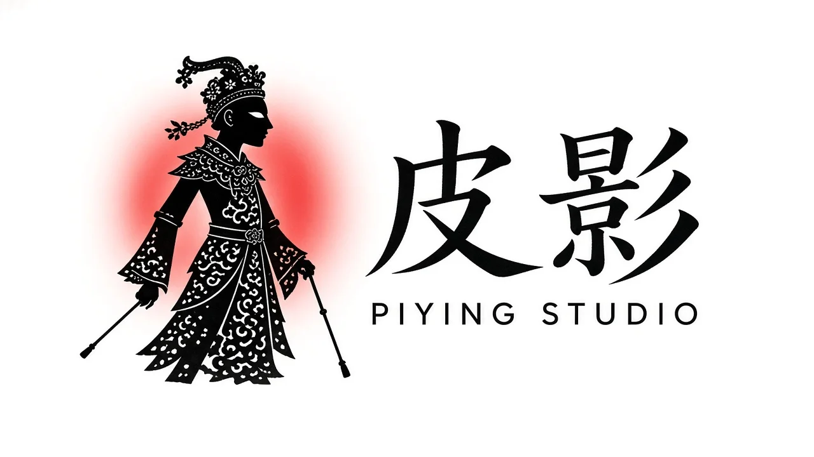

<p align="center"></p>

# 皮影 Piying Studio

基于 [dsh-shisei](https://www.npmjs.com/package/dsh-shisei) 0.2.2（作者 wquguru，Apache-2.0，三个工作流为 GPL-3.0）修改的版本。
原 README 见 README.shisei.md，许可证见 LICENSE、LICENSES/、NOTICE。

## 改了什么

- **本地 ComfyUI 模式**：`config set comfy_url http://127.0.0.1:8188` 后，不再租优云智算，不计费，直接用你自己的 ComfyUI。详见 LOCAL_MODE.md。
- **导演看图走魔搭**：`vision_*` 配置可以指向魔搭 API-Inference（Qwen/Qwen3.5-35B-A3B），已实测。

## 安装（从本仓库）

```bash
git clone https://github.com/sincalanon/piying-studio.git
dsh plugin --profile web add "$PWD/piying-studio"
```

插件内部名称仍是 `dsh-shisei`，方便 dsh 识别；和 npm 上的原版不要同时装。

原版说明（Shisei）见 [README.shisei.md](README.shisei.md)。
