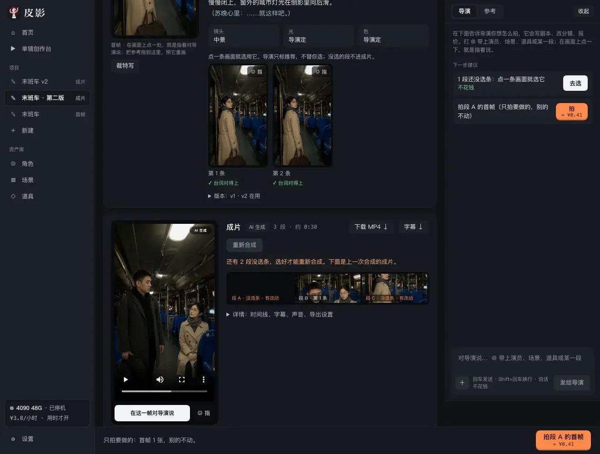
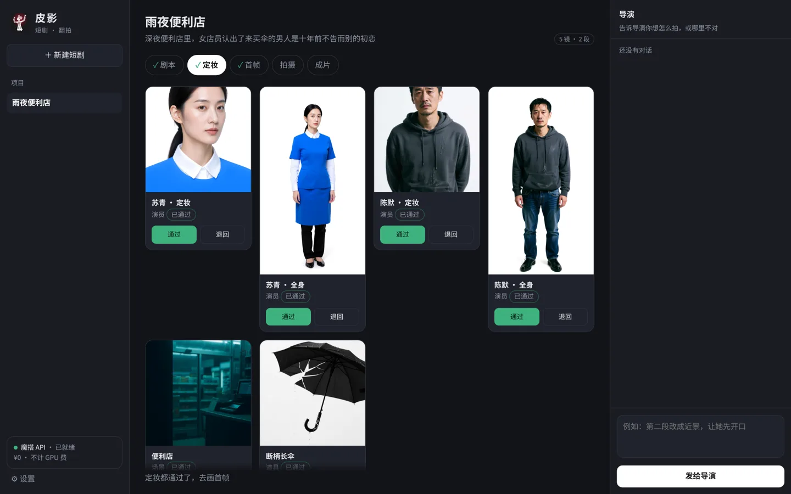

<p align="center"></p>

<h3 align="center">一句话拍成竖屏短剧 · 给舞蹈视频换上 AI 角色</h3>
<p align="center">开源、自托管的 AI 视频工作台（DeepSeek Harness 插件），跑在云端 GPU 或你自己的 ComfyUI 上</p>

<p align="center"></p>

---

## 目录

- [皮影能做什么](#皮影能做什么)
- [选一种运行方式](#选一种运行方式)
- [准备](#准备)
- [安装](#安装)
- [第一次打开：配置](#第一次打开配置)
- [使用指南](#使用指南)
- [不装 dsh：皮影独立版](#不装-dsh皮影独立版)
- [本地 ComfyUI 模式](#本地-comfyui-模式)
- [花钱、安全和隐私](#花钱安全和隐私)
- [常见问题](#常见问题)
- [和原版的区别](#和原版的区别)
- [许可与致谢](#许可与致谢)

## 皮影能做什么

| 场景 | 你做什么 | 得到什么 |
| :--- | :--- | :--- |
| **拍竖屏短剧** | 写一句话故事，逐张审角色、场景、道具和首帧，点「开机并拍」，每段从几条里挑一条 | 9:16 MP4 成片，含对白、内心独白、环境声，统一响度，带软字幕，画面无水印 |
| **对话改镜头** | 在导演栏里打 `@` 点名角色或段落，或在画面上画圈，说哪里不对 | 只重拍那一段，旧首帧和旧视频随时能换回来 |
| **照对标片写** | 选一段本机参考视频（≤ 3 分钟），再给一句你自己的故事 | 学它的景别、运镜和光线写出新剧本；只学拍法，原片不上传 |
| **拍系列** | 把几集归进一个系列，审过的角色设为常驻 | 新的一集自动带上固定的角色和声音 |
| **舞蹈翻拍** | 上传舞蹈视频（2–15 秒的一段，或整段最长 5 分钟）、成年角色的全身图和脸部特写，再写一句衣服描述 | 原视频、3D 白模、翻拍结果三栏对照的成片 |

## 选一种运行方式

| | 云端 GPU（原版方式） | 本地 ComfyUI（皮影新增） |
| :--- | :--- | :--- |
| 机器 | 租[优云智算](https://www.compshare.cn/) 4090 48G，按秒计费 | 你自己的电脑或局域网机器 |
| 花费 | 30 秒短剧实测约 ¥3–6 | 不花 GPU 的钱，只有电费 |
| 显存 | 平台提供 48G | 短剧出图：Qwen-Image 2.1，越大越好；拍视频和翻拍：MiniMax H3，要 48G |
| 适合 | 没有大显卡；要完整跑短剧和翻拍 | 已经装好 ComfyUI；先拿出图环节试水 |

两种方式可以随时切换：设置了 `comfy_url` 就走本地，清空就回到云端。

## 准备

- **系统**：macOS 或 Windows 11。翻拍目前只在 macOS 上验证过。
- **[dsh](https://github.com/deepseek-ai/deepseek-harness) 0.2.x**（DeepSeek Harness，开源 agent 工具，带网页界面）。桌面版自带 Python；命令行版另需 Node 20+ 和 Python 3.9+。
- **ffmpeg** 4.4+：插件第一次打开时可以在「设置」里一键安装。
- **导演模型**：在 dsh 里配一个能看图的大模型。推荐直接用魔搭（见下文）。
- **云端方式还需要**：优云智算账号（实名、充值、在控制台拿 API 公钥和私钥）。
- **本地方式还需要**：一个能访问的 ComfyUI，以及对应的节点和模型（见[本地 ComfyUI 模式](#本地-comfyui-模式)）。

## 安装

从本仓库安装：

```bash
git clone https://github.com/sincalanon/piying-studio.git
# 仅首次：从 dsh 内置模板建一个 profile，已有就跳过
dsh --profile web --from-default-profile web --dump-config >/dev/null
dsh plugin --profile web add "$PWD/piying-studio"
dsh --profile web
```

- **dsh 桌面版**：原版说明里桌面版只能在插件页「Add plugin」里按 npm 名称安装，能不能填本地文件夹要看你的 dsh 版本；不行就用上面的命令行版安装。
- 插件内部包名仍是 `dsh-shisei`，所以不要和 npm 上的原版同时安装。已经装过原版的话，先卸载再装。
- **升级**：在仓库目录 `git pull`，然后重启 dsh。项目、配置和花费账本都在 `~/.dsh/shisei/`，升级和卸载都不会动它们。

## 第一次打开：配置

打开 dsh 网页左栏的「Piying」（皮影），按「开始」页一步步来。命令行用户可以用下面的命令完成同样的配置（`S` 是脚本路径）：

```bash
S=piying-studio/skills/shisei-motion/scripts/shisei.py
python3 -I $S doctor                 # 检查环境
```

### 导演看图模型 → 魔搭（免费额度）

```bash
python3 -I $S config set vision_base_url https://api-inference.modelscope.cn/v1
python3 -I $S config set vision_model Qwen/Qwen3.5-35B-A3B
python3 -I $S config set vision_key_env MODELSCOPE_API_KEY
python3 -I $S config set vision_source key
export MODELSCOPE_API_KEY=ms-你的令牌      # 魔搭「访问令牌」，账号需绑定阿里云并实名
python3 -I $S vision-test               # 应答出红、绿、蓝三个色块
```

写剧本的导演模型在 dsh 自己的模型设置里配。魔搭也是 OpenAI 兼容接口：base URL 填 `https://api-inference.modelscope.cn/v1`，模型填 `Qwen/Qwen3.5-35B-A3B`。

### 出图出视频 → 二选一

- **云端**：「开始」页填优云智算的公钥、私钥，生成 ssh 密钥，建一台 GPU 机器（约 10 分钟、不到 ¥1）。
- **本地**：`python3 -I $S config set comfy_url http://127.0.0.1:8188`，再 `python3 -I $S tunnel` 检查能否连上。

## 使用指南

### 1. 拍第一部短剧

1. **写剧本（不花钱）**：点「新建项目」→「短剧」，填片名和一句话故事，点「让导演写剧本」，约 7–10 分钟。新手可以直接复制内置的练手剧本《打烊之后》《末班车》《晾衣绳》。
2. **画设定图（GPU）**：点底栏标着价钱的按钮。确认框会列出机器、单价和预计费用，点「开机并拍」。本地模式下价格显示为 0。
3. **审图（本机）**：演员、场景、道具逐张「通过」，或「退回」并写一句原因，导演会照原因改了再画。
4. **审首帧（本机）**：每段约 10 秒，配一张首帧。对照取景、长相年龄、服装道具三项提示，由你点「通过」。
5. **拍视频、选条（GPU）**：每段拍几条候选，你点一条（数字键 `1` `2` 选，`⌘Z` 撤销）。
6. **合成（不花钱）**：本机统一响度、封软字幕，然后下载 MP4。

命令行里对应的是：

```bash
python3 -I $S drama-new --template closing          # 从练手剧本新建，输出项目目录
python3 -I $S drama-estimate <项目目录> assets       # 先看价钱
python3 -I $S drama-run <项目目录> assets --confirm-billing
# 之后依次是 keyframes、takes 三个阶段，审图和选条在页面里做
```

### 2. 和导演说话

- 每个项目有一个导演会话，聊天不花 GPU 的钱。
- 打 `@` 可以带上演员、场景、道具、某一段或某一条视频，也可以带别的项目或素材库里的图。
- 在画面上点一下或拖一个框，圈出的局部会和整帧一起发给导演。
- 「停下」只停导演，不停 GPU。

### 3. 三个重做办法

- **裁特写**：人物太远时在首帧上框一块，重画成清晰的特写（最多放大 6 倍）。
- **两人侧脸相对**：修两人对视时都扭头看镜头的问题。
- **换衣**：把素材库里或你上传的衣服图拖到演员照片上，重画。

这三种都只改项目数据，下次点「拍」才会开机。

### 4. 对标片：只学拍法

在首页故事框旁点「对标片」，选一段本机视频。本机切镜、抽帧，看图模型逐镜填写景别、运镜、光线和人数，汇总成每段的骨架交给导演。原片的人物、台词和画面都不会进项目。

### 5. 舞蹈翻拍

首页切到「翻拍」，上传舞蹈视频、成年角色的全身正面图和脸部特写，写一句衣服描述。确认开机后依次跑 SAM 3D Body 动捕、Blender 白模、MiniMax H3 换人，输出三栏对照成片。不满意可以加拍或改衣服重拍，动捕和白模会直接复用。

## 不装 dsh：皮影独立版

只要 Python 3.9+ 和 ffmpeg，不用装 dsh 和显卡：

```bash
git clone https://github.com/sincalanon/piying-studio.git
cd piying-studio
export MODELSCOPE_API_KEY=ms-你的令牌      # 也可以打开网页后在「设置」里填
python3 studio/app.py                      # 浏览器打开 http://127.0.0.1:7860
```

<p align="center"></p>

- **导演**：魔搭的对话模型（默认 `Qwen/Qwen3.5-122B-A10B`）按 `skills/shisei-drama/SKILL.md` 的规矩写 story.json，`drama-set` 检查不过就把问题发回给它重写，最多 4 轮。实测一句话故事约 40 秒写出 5 镜 2 段的剧本。
- **出图、拍视频**，在「设置」里二选一：
  - **魔搭 API**（默认，不用显卡）：`studio/ms_comfy.py` 在本机扮成一个 ComfyUI，把定妆和首帧交给 `Qwen/Qwen-Image` / `Qwen/Qwen-Image-Edit`，把视频交给 `MiniMax/MiniMax-H3`（用首帧生成，3/5/10 秒，带声音）。
  - **自己的 ComfyUI**：填地址（同一台电脑再填文件夹），走[本地 ComfyUI 模式](#本地-comfyui-模式)。
- **网页**：左边是项目，中间按「剧本 → 定妆 → 首帧 → 拍摄 → 成片」逐步推进，每张图点「通过 / 退回」，每段选一条视频，最后点「合成成片」；右边是导演，可以随时说哪里要改。
- 项目和插件版共用 `~/.dsh/shisei/jobs/`，两边都能打开。
- 魔搭限制：视频只按首帧生成，不用角色参考图和声音样本，同一角色在不同段的长相和声音可能有出入；真人照片会被内容审核拦下；视频（MiniMax-H3）消耗魔搭账号余额，余额不够时会提示 insufficient balance。舞蹈翻拍要 48G 显卡，独立版不支持。

## 本地 ComfyUI 模式

完整说明见 [LOCAL_MODE.md](LOCAL_MODE.md)。要点：

```bash
python3 -I $S config set comfy_url http://127.0.0.1:8188        # 打开本地模式；设成空字符串就关掉
python3 -I $S config set comfy_dir "D:/ComfyUI"                 # 可选：ComfyUI 就在本机时填它的文件夹
python3 -I $S config set comfy_model_roots "E:/models"          # 可选：模型放在别的地方时填
```

- 没有开关机，没有计费，也没有定时停机。租约照常生效，两个项目不会同时抢同一个 ComfyUI。
- 填了 `comfy_dir`，文件直接复制进 `input/`、从 `output/` 取回；没填就走 HTTP 的 `/upload/image` 和 `/view`，ComfyUI 可以在局域网的另一台机器上。
- 连本机地址时不走系统代理。
- 开拍前会检查 `comfy_dir/models` 里的模型文件，缺了会列出来，但不会自动下载。

**短剧出图需要的节点和模型**

- 节点：`TextEncodeQwenImage21`、`QwenImage21Cache`（需要新版 ComfyUI）
- `diffusion_models/qwen_image_2.1_int8_convrot.safetensors`
- `text_encoders/qwen3vl_8b_int8_convrot.safetensors`
- `vae/qwen_image_2.1_vae_bf16.safetensors`

**显存提醒**：拍视频（`drama_take`）和翻拍（`swap_studio`、`mocap_glb`）用的 MiniMax H3 要 48G 显存。8G 显卡只能靠内存卸载尝试出图，跑不动 H3。

**魔搭云端视频（实验）**：魔搭 API-Inference 的 `MiniMax/MiniMax-H3` 已实测能用首帧生成 5 秒、704×1280、带声音的视频（约 5 分钟）。限制是只收 1 张首帧，图必须在魔搭自己的图床上（比如魔搭 Qwen-Image 的出图），真人照片会被内容审核拦下。插件还没有接入这条路。

## 花钱、安全和隐私

这些规则写在代码里，不能关：

- **开机必须你点**：不点「开机并拍」就不会开机，导演的 shell 里任何会计费的命令都被拒绝。每个项目默认预算上限 ¥5。
- **以平台账单为准**：拍完后机器空闲 10 分钟才自动停机，这段时间平台也计费。
- **只停机，不删东西**：插件只会停机，从不删实例和磁盘；换掉的首帧和视频都留着旧版本。
- **角色至少 18 岁**：标为「看起来年轻」的角色只用原始身形，不换更暴露的衣服。用真人照片当参考时，取得本人同意、遵守当地肖像权和深度合成标识规定是使用者的责任。
- **ComfyUI 不暴露到公网**：云端只监听 `127.0.0.1`，经 ssh 隧道访问；队列里出现不是插件提交的任务时会告警并暂停。
- **数据去向**：没有遥测，也没有皮影自己的服务器。数据只发往你配置的几处：GPU 平台 API、你的 GPU 机器或本地 ComfyUI、导演模型、看图模型，以及只读的公开素材库 `shisei.indaloop.app`。

## 常见问题

<details>
<summary><b>要花多少钱？</b></summary>

插件免费。云端方式只为 GPU 按秒付费，原作者实测 29.4 秒的《末班车》约 ¥3，40 秒的《晾衣绳》约 ¥5.9（含空闲待机）。本地方式不花 GPU 的钱。导演模型和看图模型的 API 费用另算，魔搭有免费额度。

</details>

<details>
<summary><b>我的显卡只有 8G，能用吗？</b></summary>

能用本地模式试出图环节，但速度和能否跑通要看内存卸载。拍视频和翻拍要 48G，建议走云端，或者等魔搭视频接入。

</details>

<details>
<summary><b>遇到问题怎么办？</b></summary>

| 情况 | 怎么办 |
| :--- | :--- |
| 本地模式提示「does not answer」 | 先启动 ComfyUI，确认 `comfy_url` 的端口一致，再运行 `tunnel` |
| 提示「model files missing」 | 按提示把模型放进 `comfy_dir/models` 对应的子目录，或用 `comfy_model_roots` 指过去 |
| 提示缺节点 | 更新 ComfyUI，或安装对应的自定义节点 |
| 看图模型不回答 | 运行 `vision-test`；确认 `MODELSCOPE_API_KEY` 已设置，魔搭账号已实名 |
| 没填密钥 / 没有 GPU 机器（云端） | 去「开始」页对应那一步，或「设置」 |
| GPU 没货（云端） | 插件每 2 分钟自动重试，等待不计费 |
| 超出项目预算 | 少拍几条或几段，或在页面里调高上限 |
| 页面还在要优云智算密钥（本地模式） | 页面的「GPU 机器」部分仍按云端设计；本地模式下命令行的 `drama-run` 等命令不需要它 |

</details>

<details>
<summary><b>能商用吗？</b></summary>

插件代码可以（见下方许可）。生成用的模型各有许可：MiniMax H3 和换人 LoRA 是 `minimax-h3-community-license`，Qwen-Image、SAM 3D Body、SAM 3.1、MoGe 也各有许可，商用前请先读。

</details>

## 和原版的区别

皮影 Piying Studio 基于 [dsh-shisei](https://www.npmjs.com/package/dsh-shisei) 0.2.2（作者 wquguru）修改：

- 新增**本地 ComfyUI 模式**（`skills/shisei-motion/scripts/local_mode.py`），配置项为 `comfy_url`、`comfy_dir`、`comfy_model_roots`。
- **导演看图可走魔搭**，已实测。
- 新的品牌名称和图标。

原版说明保留在 [README.shisei.md](README.shisei.md)，英文、日文、韩文原版说明见 README.en.md、README.ja.md、README.ko.md。

## 许可与致谢

- 插件代码按 Apache-2.0 分发（[LICENSE](LICENSE)）。修改记录见 [NOTICE](NOTICE)。
- `skills/shisei-motion/assets/workflows/` 下的 `swap_studio.json`、`drama_take.json`、`mocap_glb.json` 按 **GPL-3.0-only** 分发（[LICENSES/GPL-3.0.txt](LICENSES/GPL-3.0.txt)）；`drama_image.json` 是 Apache-2.0。
- `assets/vendor/wheels/` 和 `lib/ssh.cjs` 里打包的第三方组件许可见 [NOTICE](NOTICE)。
- 模型和素材库都不随插件分发。
- 致谢：原作者 wquguru、[DeepSeek Harness](https://github.com/deepseek-ai/deepseek-harness)、ComfyUI、[ComfyUI-BFSNodes](https://github.com/alisson-anjos/ComfyUI-BFSNodes)、Qwen-Image、MiniMax H3、SAM 3D Body、SAM 3.1、MoGe、Blender、ffmpeg、魔搭 ModelScope。
- 本项目和 DeepSeek、优云智算、MiniMax、魔搭都没有关联。
